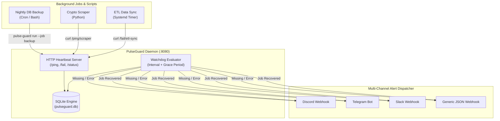

# 🛡️ PulseGuard: Self-Hosted Deadman's Switch & Cron Heartbeat Monitor

<div align="center">

[](https://github.com/hazefund/pulse-guard)
[](https://www.python.org/)
[]()
[]()
[](https://opensource.org/licenses/MIT)

**A lightweight, zero-dependency heartbeat monitor and deadman's switch daemon designed to catch silent background failures in cron jobs, scrapers, data pipelines, and backup scripts.**

[Architecture](#-architecture) • [Features](#-key-features) • [Quickstart](#-quickstart) • [Crontab Examples](#-crontab-integration) • [Alert Configuration](#-alert-configuration)

</div>

---

## 🏛️ Why PulseGuard?

Silent background failures are among the most dangerous issues in production infrastructure:
- A nightly database backup script crashes due to disk permissions, and nobody notices until disaster recovery is needed.
- A financial data scraping pipeline hangs or hits an unexpected API rate limit.
- An ETL sync job silently halts, corrupting downstream analytical dashboards.

Third-party cloud services charge recurring subscription fees and introduce external SaaS dependencies into your private infrastructure.

**PulseGuard** is a standalone, lightweight daemon you can self-host on any server or VPS in seconds. It listens for periodic HTTP heartbeats and immediately dispatches alerts across **Discord, Telegram, Slack, or generic webhooks** when a job misses its scheduled window or exits with an error.

---

## 📐 Architecture



---

## 🚀 Key Features

- **Zero External Dependencies:** Built 100% on the Python standard library (`http.server`, `sqlite3`, `urllib.request`). No heavy frameworks, no bloated node modules, runs instantly on any minimal Linux/macOS host.
- **Deadman's Switch Logic:** Tracks expected execution intervals (e.g. `15m`, `2h`, `1d`) with configurable grace buffers. If a heartbeat is missed, an alarm is triggered.
- **Smart Command Wrapper (`pulse-guard run`):** Wraps any existing bash command or script, measures execution duration, captures stderr on crashes, and auto-pulses success or failure.
- **Multi-Channel Dispatcher:** Native out-of-the-box support for Discord, Telegram, Slack, and generic webhooks with rich Markdown embeds and colored severity indicators.
- **Automatic Recovery Notifications:** Automatically notifies your team when a previously failing or late job comes back online.
- **Persistent SQLite Audit Log:** Preserves job status, historical runtimes, and exit codes across daemon restarts.

---

## ⚡ Quickstart

### 1. Installation

```bash
git clone https://github.com/hazefund/pulse-guard.git
cd pulse-guard
pip install -e .
```

### 2. Start the Daemon

Start the background listener:

```bash
pulse-guard serve --port 8080 --config pulseguard.yaml
```

Output:
```text
╔══════════════════════════════════════════════════════════╗
║               🛡️  PulseGuard Heartbeat Daemon            ║
╚══════════════════════════════════════════════════════════╝
📡 Webhook Ingestion API: http://0.0.0.0:8080/ping/<job_id>
💾 Persistent Storage:    pulseguard.db
📢 Active Channels:       ['ConsoleNotifier', 'DiscordNotifier', 'TelegramNotifier']
────────────────────────────────────────────────────────────
```

### 3. Send a Heartbeat

You can ping PulseGuard using `curl` from any language or environment:

```bash
# Simple ping with expected 24h interval and 15m grace period
curl "http://localhost:8080/ping/db-backup?interval=1d&grace=15m"
```

Or using the CLI:

```bash
pulse-guard ping db-backup --interval 1d --grace 15m
```

### 4. Check Job Status

View the real-time health table of all registered background tasks:

```bash
pulse-guard status
```

```text
╔════════════════════════════════════════════════════════════════════════════════════════════╗
║                              🛡️  PulseGuard Job Registry                                    ║
╚════════════════════════════════════════════════════════════════════════════════════════════╝

  Job Name             Status     Interval   Last Ping (UTC)        Duration   Exit
  ────────────────────────────────────────────────────────────────────────────────────
  db-backup            🟢 HEALTHY 86400s     2026-09-27 21:30:15    12.4s      0
  market-scraper       🟢 HEALTHY 3600s      2026-09-27 22:15:00    2.8s       0
  indexer-sync         🔴 LATE    900s       2026-09-27 20:00:10    45.1s      -
```

---

## 🛠️ Crontab Integration

### Option A: The Smart Wrapper (`pulse-guard run`)
The simplest way to monitor any command. It executes your task, tracks duration, captures output, and reports success or failure automatically:

```crontab
# Runs database backup every midnight; alerts if it takes > 24h or if the script exits with code != 0
0 0 * * * pulse-guard run --job pg-backup --interval 1d --grace 30m -- /usr/local/bin/backup.sh
```

### Option B: Native `curl` One-Liner
If you prefer not to install the CLI on worker nodes, you can simply append a curl call to your crontab:

```crontab
0 2 * * * /opt/scripts/export.sh && curl -fsS "http://monitoring-server:8080/ping/export-job?interval=1d"
```

---

## 🔔 Alert Configuration

Create a `pulseguard.yaml` file (see `pulseguard.example.yaml`):

```yaml
server:
  host: "0.0.0.0"
  port: 8080
  database_path: "pulseguard.db"

alerts:
  # Discord Webhook
  discord_webhook: "https://discord.com/api/webhooks/12345/abcdef..."

  # Telegram Bot
  telegram_bot_token: "123456789:ABCDefGhIJKlmNoPQRsTUVwxyZ"
  telegram_chat_id: "-100123456789"

  # Slack Webhook
  slack_webhook: "https://hooks.slack.com/services/T00/B00/XXXX"
```

Or configure via environment variables:
- `PULSEGUARD_DISCORD_WEBHOOK`
- `PULSEGUARD_TELEGRAM_BOT_TOKEN`
- `PULSEGUARD_TELEGRAM_CHAT_ID`
- `PULSEGUARD_SLACK_WEBHOOK`

---

## 🧪 Testing

Execute the test suite using `pytest`:

```bash
pytest
```

All 5 core tests verify:
- Duration string parsing (`30s`, `15m`, `2h`, `1d`).
- Watchdog state transitions (`HEALTHY` $\rightarrow$ `LATE`).
- Deduplicated alert dispatching to avoid alert storms.
- Recovery notifications when overdue jobs check in.
- SQLite persistence and history logging.

---

## ⚖️ License

Distributed under the **MIT License**. See `LICENSE` for details.

---

<div align="center">
  <sub>Maintained by <b><a href="https://github.com/hazefund">@hazefund</a></b> • High-Reliability Developer & Market Tooling</sub>
</div>
